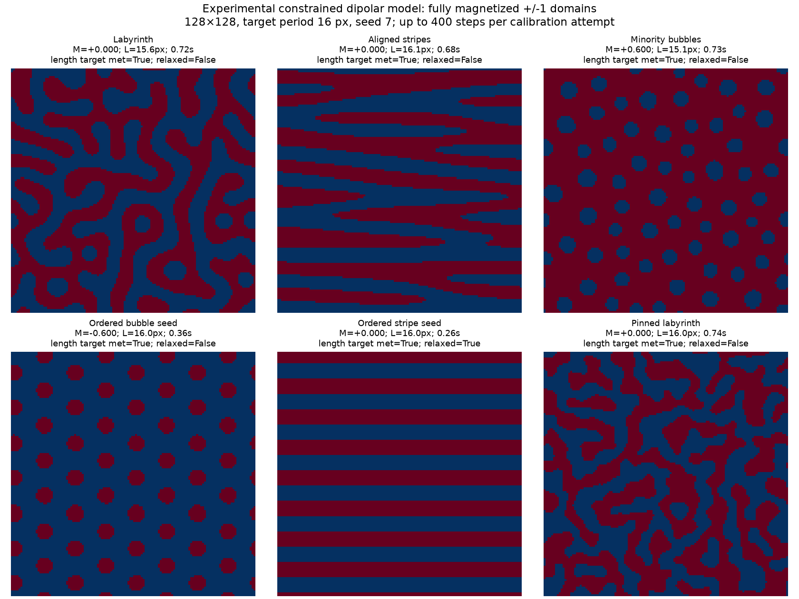

# Experimental constrained dipolar magnetic domains

`create_constrained_domain_pattern` is a first experimental scalar relaxation
model for fast synthetic magnetic textures. It generates fully magnetized
+1/-1 output. A numeric `target_magnetization` enforces the requested sign-area
fraction **during every relaxation step**; `None` lets mean magnetization evolve
freely and measures the achieved occupancy afterward. It is available in all workflows as
`pattern_type_method="constrained_domain_pattern"`.

It follows the competing-interaction model structure described by
[Jagla, PRE 70, 046204 (2004)](https://arxiv.org/html/cond-mat/0402406): local
saturation, interfacial stiffness and nonlocal dipolar competition evaluated
spectrally. The exact sign-area projection, directional control, clipping and
length calibration are our extensions, not a verbatim paper algorithm.
See the [literature review](magnetic_domain_model_research.md).

For collaborator-facing definitions, HDF5 loading, plotting and CSV examples,
start with the [magnetic-pattern analysis guide](magnetic_pattern_analysis.md).

## Use

```python
from scattering_calculator.sample_generator import create_constrained_domain_pattern
mz, metadata = create_constrained_domain_pattern(
    (128, 128),
    target_magnetization=0.0,
    characteristic_length=16.0,
    alignment=0.0,
    direction=0.0,
    disorder=0.0,
    initial_state="random",
    initial_order=0.0,
    n_steps=400,
    seed=7,
)
```

Direct lengths are pixels. In `MagneticPatternConfig`,
`characteristic_length` and `disorder_length` are in metres and are converted
at the shared generator boundary. `direction` is a stripe-axis angle in radians,
from +x towards +y in array coordinates.

| Control | Meaning |
|---|---|
| `target_magnetization` | `None` for free evolution, or normalized M/Ms in [-1,1] for a sign-area constraint. With a numeric target, up fraction is (1+M)/2 and up-pixel count is rounded to the nearest integer. |
| `characteristic_length` | Target **full repeat/spacing**, not stripe thickness or bubble diameter. Measured using an interpolated radial Fourier-power peak. |
| `alignment`, `direction` | Directional interaction penalty for variations along the stripe axis. At zero alignment the interaction is isotropic. |
| `disorder`, `disorder_length` | Strength and Gaussian correlation scale of quenched random-field pinning. |
| `initial_state`, `initial_order` | Random, stripe or hexagonal preparation and its blend with band-limited random initialization. Preparation is distinct from the directional energy penalty. |
| `wall_stiffness` | Dimensionless strength of the auxiliary field's local double-well potential; default 2. |
| `n_steps`, `time_step` | Maximum relaxation steps per attempt and dimensionless solver time increment. |
| `convergence_tolerance` | Auxiliary-field RMS update criterion; must hold for five consecutive steps. |
| `length_tolerance`, `max_length_iterations` | Relative size tolerance and bounded calibration attempts; defaults 0.15 and 5. One attempt disables length feedback. |

At saturated magnetization the output is uniform, relaxation is skipped and
measured length is `None`. When enabled, the area target applies to the **full generated
grid**. Cropping with an object-hole aperture can change the observed local
fraction; it does not define a material boundary for this periodic solver.

## Implemented model

For the smooth auxiliary field u, the local energy density is
alpha*(u²-1)²/4. The dimensionless Fourier interaction is

    K(k) = (|k|/q0)² - 2|k|/q0 + alignment*(k·stripe_axis/q0)².

The first two terms represent interfacial stiffness competing with the
long-wavelength dipolar contribution. Their isotropic minimum is at q0.
This uses the long-wave approximation, not a finite-thickness demagnetizing
kernel. The interaction is set to zero at k=0. With a numeric target, sign-area
projection constrains occupancy separately; with `None`, the mean evolves freely.

A stabilized semi-implicit spectral update relaxes u, followed by clipping of u to [-1,1]. With a numeric magnetization target,
a level-set shift first matches the exact requested sign area; with `None`,
that area projection is skipped.
The final binary sign field is the output magnetization; intermediate amplitude
is an internal wall representation, not reduced magnetization strength.
The projection/clipping extensions do not guarantee monotonic energy descent.
The recorded energy and residual trace is diagnostic, not a proof of convergence
to a physical ground state. Boundary conditions are periodic.

The requested spacing is calibrated by repeated same-seed relaxations with an
adjusted preferred interaction scale. Because topology changes and finite-grid
spectra are discrete, the response need not be monotone. The best measured
attempt is returned. Check **both** `length_target_met` and `converged`; neither
is silently assumed. `calibration_history` records every attempted scale.
The raw single-pixel FFT peak and the radial-peak period are retained separately.

## Measured trial



The reproducible script generates 54 scan trials (three target magnetizations,
three lengths, two alignment strengths, three seeds), plus six named examples.
All are 128×128, with at most 400 steps per calibration attempt. In the 54 scan
trials, 44 met the 15% length tolerance; median runtime was approximately 0.71 s
(range 0.32–1.97 s on this machine). None of these scan trials met the strict
1e-5 residual convergence criterion within that budget. The ordered-stripe
example did converge. These are finite-step textures, not established ground
states. All trials preserved the rounded sign-area constraint. Titles report
the actual achieved length, runtime, size-target flag and convergence flag.

- [Full trial records](assets/constrained_domains/measurements.json), including
  residuals, area counts, energy traces and calibration history.
- [CSV summary](assets/constrained_domains/measurements.csv).
- [Tutorial 22](../tutorials/22_general_magnetic_domains.ipynb) exposes editable
  controls before the procedural baseline examples.

Reproduce with:

```bash
PYTHONPATH=src python scripts/catalogue_constrained_domains.py
```

These are timed scalar-model trials, **not a speed or fidelity comparison to
MuMax3 or another LLG solver**. Material calibration, resolution/time-step
convergence, a finite-thickness kernel and reference micromagnetic comparisons
remain necessary before treating this as a validated surrogate. Vector domain
walls, DMI, chirality, skyrmion topology and physical-time switching dynamics
are outside this first backend.

## Isolated minority worms at large net magnetization

Use `initial_state="worms"`, `initial_order=1`, and `initial_domain_count=1` or
`2` to prepare finite curved minority domains. Their polarity is automatically
chosen opposite to the sign of a numeric `target_magnetization`. With `None`,
a positive initial tube of half-width 0.25 times the preferred spacing is used
in a negative background; subsequent evolution can change its area freely. `worm_length` and
`worm_waviness` set the initial centerline length and bending amplitude; direct
units are pixels and pipeline configuration units are metres. Omitted values
use 0.6 and 0.06 times the shorter grid dimension. The required minority area
sets the initial width. Subsequent relaxation may change length, width and
component count; the count is not an enforced topological constraint.

Tutorial 22 compares M=-0.9, -0.8, +0.8, +0.9 and one/two-worm preparations.
The two-worm |M|=0.9 recipe reduces the preferred interaction scale from 24 to
16 pixels to accommodate thinner minority domains. At the larger scale these
can fragment into four bubbles instead; this is not a fixed-topology solver.
The zero-alignment examples preserve isolated, elongated domains at the tested
finite relaxation budget. Large alignment may extend worms across periodic
boundaries. Disable global length calibration (`max_length_iterations=1`)
when exploring these few-domain states: a global spectral repeat and isolated
worm length are different observables. Check actual components and boundary
contacts, not just the initial count.

## Production hologram generation

`tutorials/simulate_hologram_sweep.py` now samples this model directly through
`sample_constrained_domain_parameters(rng)`; the former Gray–Scott phase map,
requested saturated/stripe/bubble handles and balanced state quotas are not used.
A preparation is an initial condition, not a requested final state. Production
holograms use **one relaxation run**, with `max_length_iterations=1`: the input
spacing sets the preferred interaction scale, and achieved spacing, morphology
and order are measured afterward. There are no retries to satisfy those output
measurements. Optional spacing calibration remains available by explicitly
setting `max_length_iterations>1`; Notebook 22 can still explore that behavior. `HologramPipelineConfig` defaults to
`pattern_type="constrained_domain_pattern"`; explicit legacy pattern types remain
available for reproducing older experiments.

```python
from scattering_calculator.simulation_pipelines.pipelines import (
    HologramPipeline, HologramPipelineConfig, HologramPipelineRanges,
)
from scattering_calculator.simulation_pipelines.magnetic_parameters import (
    sample_constrained_domain_parameters,
)
import numpy as np

rng = np.random.default_rng(7)
config = HologramPipelineConfig(recipe="Au(100)/SiN(20)/Co(6)")
ranges = HologramPipelineRanges(
    pattern_config=lambda params: sample_constrained_domain_parameters(rng),
)
pipeline = HologramPipeline(config=config, ranges=ranges,
    output_path="domains.h5", n_samples=10)
pipeline.run()
```

All lengths passed through `MagneticPatternConfig` or the pipeline are **metres**,
including `sigma`, `worm_length` and `worm_waviness`. Direct calls to
`create_constrained_domain_pattern` use **pixels** and return strictly binary
patterns. That low-level generator does not apply wall blur.

The shipped exploratory sampler uses independent draws over the following
controls. Edit this function or provide your own callable to choose a study's
parameter distribution. The distribution intentionally does not guarantee
balanced measured states.

| Control | Sweep distribution | Meaning / constraint |
|---|---|---|
| `characteristic_length` | uniform 120–1000 nm | Full repeat/spacing; not a domain diameter. |
| `target_magnetization` | `None` by default; optional numeric fixed target or sampled uniform −0.95–0.95 with 10% replaced by ±1 | Free evolution when null. Numeric targets fix rounded sign area; ±1 generates saturation. |
| `alignment` | choice 0, 0.5, 2, 8, 24 | Nonnegative directional penalty; larger values favor stripe alignment. |
| `direction` | uniform 0–π radians | Stripe axis from +x toward +y. |
| `disorder` | uniform 0–0.8 | Quenched random-field strength, not detector noise. |
| `disorder_length` | 0–0.15 × characteristic length | Gaussian disorder correlation sigma; zero permits uncorrelated disorder. |
| `initial_state` | random, stripes, hexagonal, worms | Initial preparation; does not fix final topology. |
| `initial_order` | uniform 0–1 | Blend of ordered preparation with random initialization. |
| `initial_domain_count` | integers 1–3 | Worm seed count; only used for worm preparation. |
| `worm_length` | 1–4 × characteristic length | Initial worm centerline length, not relaxed length. |
| `worm_waviness` | 0–0.3 × characteristic length | Initial worm bending amplitude. |
| `wall_stiffness` | uniform 1–4 | Auxiliary double-well strength; distinct from optical wall blur. |
| `n_steps` | choice 100, 300, 600 | Maximum steps in the one production relaxation run. |
| `time_step` | choice 0.05, 0.1, 0.2 | Positive dimensionless solver step. |
| `convergence_tolerance` | log-uniform 10⁻⁵–10⁻³ | RMS auxiliary update threshold; five consecutive checks required. |
| `length_tolerance` | fixed 0.15 | Diagnostic tolerance for `length_target_met`; does not trigger a retry. |
| `max_length_iterations` | fixed 1 | One generated realization; no measured-spacing feedback. |
| `sigma` | 0.025–0.06 × characteristic length | Gaussian domain-wall blur standard deviation, not FWHM or wall stiffness. |
| `seed` | integer draw | Reproducible field, preparation and disorder realization. |

Defaults for a fixed generator call remain in the generator's Python signature.
A bare hologram pipeline supplies `characteristic_length=160e-9` and `sigma=5e-9`
if omitted, and defaults to `max_length_iterations=1`. It records these effective
values, not just the supplied overrides. Production defaults to `target_magnetization=None`.
The low-level generator retains its
optional calibration default for notebook/research callers. `target_magnetization`
controls sign area during relaxation only when numeric; `None` disables that
constraint. It is not a final-state quota or rejection/resampling condition. Wall blur is applied after the binary run.

### Binary topology, walls and spatial sampling

The order of operations is:

1. Relax the scalar model once on the **actual fine simulation grid**, without
   calibrating its measured spacing unless explicitly enabled.
2. Retain the resulting ±1 map for domain classification and provenance.
3. Apply Gaussian wall smoothing on that grid, using periodic filter boundaries
   consistent with the generator. `sigma=0` or `None` explicitly disables blur.
4. Build the magnetization used by the optics. The paired hologram pipeline uses
   `(mx,my,mz)=(0,sqrt(1-mz²),mz)`, retaining unit magnitude through its Bloch-like
   wall convention. This is not a vector micromagnetic wall relaxation or a
   chirality model. Subsequent aperture, material, illumination, propagation and
   detector effects remain part of the hologram simulation.
5. Count and measure the **binary pre-blur** domains that intersect the OH.

Gaussian filtering preserves the full-grid mean with periodic boundaries, but
can shift the local sign boundary and the OH-observed mean. The calibration and
area constraint refer to the binary precursor, not the blurred sign fraction.
There is no nearest-neighbor enlargement of a low-resolution binary source.

The hologram backend increases integer oversampling when needed so that the
requested characteristic length spans **at least 16 pixels** and positive wall
sigma spans **at least 2 pixels**. For detector-derived resolution `r`, it uses

```text
target_pitch = min(characteristic_length / 16, sigma / 2)  # omit sigma term if disabled
f_minority = 0 if target_magnetization is None else (1 - abs(target_magnetization)) / 2
if f_minority > 0:
    target_pitch = min(target_pitch, characteristic_length * f_minority / 4)
actual_oversampling = max(requested_oversampling, ceil(r / target_pitch))
actual_pixel_size = r / actual_oversampling
```

The physical field of view remains fixed while the simulation grid gains
pixels. `magnetic_pattern_max_grid_axis` (default 4096) limits each full-grid
axis; exceeding it raises before sample/grid allocation. It does not silently
coarsen the wall. Reduce detector distance or change physical parameters, or
explicitly raise the limit after considering memory. The sweep's detector
distance sampler also accounts for wall and domain resolution to reduce the
need for automatic refinement. `farfield_oversampling` only pads the exit wave
for the detector FFT and does **not** refine magnetic domains.

For an explicit-grid `ScatteringExperiment`, select a sufficiently fine
`simulation.real_space_pixel_size` yourself. `MagneticPatternConfig` rejects
spacing below 16 pixels, positive sigma below 2 pixels, or a nonzero minority
stripe-width estimate below 4 pixels. These minima prevent
gross undersampling; they are not a substitute for checking hologram convergence
on a finer grid for a scientific study. Highly irregular or unusually narrow relaxed domains can still need finer
sampling; inspect the realized geometry and check numerical convergence.

With magnetic ROI optimization, generation uses the **actual OH support bounds**,
not the wider top surface of the tapered aperture. The per-side context is
`magnetic_pattern_context_periods * characteristic_length + 4*sigma`, with
`magnetic_pattern_context_periods=0.5` by default. Each nonsaturated generation
axis spans at least two requested repeat lengths and is rounded up to an
FFT-friendly length, bounded by the full simulation grid. Uniform states need
only the OH bounds (with the generator's minimum axis size of eight pixels).
The native pixel pitch and wall resolution are unchanged; the optimization
reduces field extent rather than stretching or downsampling a binary texture.

Increase `magnetic_pattern_context_periods` when studying dependence on the
periodic box size. Changing the generated extent changes finite-size effects,
the initialized realization for a seed and the domain statistics; the reduced
box is not numerically identical to a crop from the older larger box. The HDF5
metadata records `context_periods`, `generation_shape_px` and ROI bounds for
reproducibility. Use the measured state and achieved spacing from the new box.

### Measured magnetic state

Classification uses both positive and negative connected domains, counting a
component **once if any pixel intersects the OH**. All shape measurements use
its full available simulation/generation extent outside the OH. Components
entirely outside the OH are excluded. The majority background counts too.

Production constrained-domain simulations use `periodic=True`: connected
components crossing opposite edges of the **generation grid** are joined,
unwrapped and classified as complete domains. A domain with visible pixels on
both sides still counts once. Its full periodic area determines the size cutoff;
any nonzero OH intersection makes it visible. Entirely hidden domains do not
contribute to counts or orientational order. Both polarities are included.

The periodic grid is the generated ROI when magnetic ROI optimization is on,
not the surrounding constant-background padding used for optical propagation.
`classification_periodic` and `classification_json/periodic` record this convention
(the latter is a key inside JSON). `boundary_fragment_count` is zero in this
mode because periodic components are complete rather than discarded fragments.

Notebook 22 retains the explicitly selected open-field counting convention for
its galleries (`periodic=False`, `boundary_context_periodic=True`). It can be
switched to `periodic=True` to match production counts; edge bubbles then join
and count once, so whole-field gallery totals can differ. Arbitrary images
without known periodic generation should use open boundaries. Generator-only
`generation_json` measurements describe the gallery/open convention; the
production `classification_json` and OH-selected measurements describe the
actual hologram specimen selection.

| Setting | Default | Interpretation |
|---|---|---|
| `magnetic_pattern_classification_min_area` | 9 pixels | Minimum **full component area**, not minimum OH overlap. Smaller components are noise. |
| `magnetic_pattern_bubble_max_eccentricity` | 0.95 | Allows ellipses up to approximately 3.2:1 axis ratio. |
| `magnetic_pattern_bubble_min_circularity` | 0.4 | Minimum `4π area / perimeter²`, using the digital four-neighbor perimeter. |
| connectivity | 8 neighbors | Diagonal contact connects domains. |
| sign threshold | 0 | Applied to the binary precursor. |

Resolved, closed components passing the eccentricity and circularity criteria
are bubbles; all other resolved components are stripe-like. A connected
labyrinth counts as one component, not as a count of its branches. Counts depend
on field of view, resolution and thresholds.

For total bubbles B and stripe-like domains S:

| Condition | `state` |
|---|---|
| B > 0, S = 1 | `bubble` |
| B = 0, S > 1 | `stripe` |
| B > 0, S > 1 | `mixed` |
| B = 0, S = 1 | `saturated` |
| B > 0, S = 0 (OH excludes background) | `bubble` |
| B = 0, S = 0 | `unresolved` |

A homogeneous full grid is one stripe-like component, so B=0, S=1. The state
rule describes resolved topology; a saturated label can coexist with discarded
small islands. Check `noise_count` and `is_uniform` before asserting strict
uniformity. The legacy `morphology` descriptor reports component mixtures
(`mixed`, `stripes`, `bubbles`, `uniform`, `noise`); it is not the state rule above.

Separate `positive_*`, `negative_*`, `majority_*` and `minority_*` bubble, stripe,
boundary-fragment and noise counts accompany the totals. Majority/minority is determined over the
full generated grid; positive is called minority at equal area fraction.

### Diagnostics and HDF5 provenance

In the paired-CR/CL hologram file, per-sample group `00000` contains:

| Path relative to `00000/` | Contents |
|---|---|
| `metadata/sample/magnetic_pattern/pattern_config/` | Effective physical generation inputs, in metres/radians/dimensionless units, including the seed. |
| `metadata/sample/magnetic_pattern/generation_json` | Full generator metadata and nested diagnostics, including effective pixel-unit controls, realized seed, calibration history and relaxation trace. |
| `metadata/sample/magnetic_pattern/classification_json` | Scalar classification plus per-component shape/visibility records for both polarities. |
| `metadata/sample/magnetic_pattern/measurements_json` | Scalar pattern diagnostics, with undefined values represented as JSON null. |
| `metadata/sample/magnetic_pattern/measurements/` | The same scalar diagnostics as named datasets; undefined values are NaN. |
| `metadata/sample/magnetic_pattern/state`, `bubble_count`, `stripe_count` | Final measured state and total counts. |
| `metadata/sample/magnetic_pattern/positive_*`, `negative_*`, `majority_*`, `minority_*` | Separate counts by phase. |
| `metadata/sample/effective_oversampling` | Actual per-sample simulation refinement. `_pipeline_config/oversampling` retains the requested baseline. |
| `metadata/sample/real_space_pixel_size` | Actual simulation pitch, metres. |
| `magnetic_pattern_oh` | Smoothed magnetization multiplied by OH transmission; may use a smaller saved output ROI. |
| `CR/ideal`, `CL/ideal`, `CR/detected`, `CL/detected` | Simulated holograms and detector outputs. |

ROI insertion bounds are recorded under `metadata/sample/magnetic_pattern/`
(`roi_y_start_px`, `roi_y_stop_px`, corresponding x bounds). They locate the
binary precursor in the full simulation. Saved output ROI bounds have the
`saved_roi_` prefix; do not assume the precursor and `magnetic_pattern_oh` have
identical shapes.

Generator diagnostics include `target_up_pixels`, achieved `up_fraction_measured`
and `mean_mz`, requested/effective/measured spacing, relative length error,
`length_target_met`, `max_length_iterations`, `calibration_enabled`, `calibration_history`,
`n_steps_requested`, `steps_completed`, `converged`, `residual`, energy/update
`trace`, elapsed time, initial worm geometry, and periodic solver boundary
conditions. `wall_sigma_m`, `wall_sigma_px`, `characteristic_length_px`,
`mean_mz_after_wall_smoothing` and `up_fraction_after_wall_smoothing` describe
optical wall processing. Calibration length and residual convergence are
independent outcomes; neither is guaranteed by the step budget.

Measurements include full-grid occupancy and mean, `up_fraction_in_oh` and
`mean_mz_in_oh`, dominant Fourier period in pixels, average minority-component
eccentricity/circularity, counts and the following order statistics:

- `stripe_nematic_order`: magnitude of the second angular moment of stripe-like
  component major axes, weighted by area and anisotropy, over both polarities.
  Parallel axes approach 1; one anisotropic connected background also gives 1.
  This does not prove local stripe alignment or translational periodicity.
- `local_sixfold_order`: mean magnitude of six-nearest-neighbor bond order around
  bubble centers; requires at least seven bubbles.
- `sixfold_order`: magnitude after averaging those complex local orders, sensitive
  to a shared lattice orientation. Differently oriented grains can retain high
  local order and lower global order.
- `interior_bubble_count` (or `interior_component_count` in scalar measurements):
  number of classified bubble centers used for bond order.

Per-component records contain polarity, label, full `area`, OH `visible_area`,
`touches_aperture`, `touches_border` (outer grid), eccentricity, circularity and
`is_bubble` and `is_boundary_fragment`. Undefined order is `None`/JSON null and NaN in numeric datasets.
These are shape and orientational measurements, not skyrmion topology or proof
of crystalline translational symmetry.

The shared `simulate_experiment` backend also saves constrained generation
provenance under `runs/000000/magnetic_state/`: `parameters_json`,
`generation_json` and named `classification/` datasets. That
backend also classifies complete periodic components and restricts counts to
OH intersections when an OH aperture is configured. The analysis mask is
used internally and is not saved. With no OH configured, it measures the full generated field.
The paired hologram backend additionally saves the detailed per-component JSON
records described above.

### Timing and live generation progress

With `HologramPipeline(verbose=True)` (the sweep default), the terminal reports
magnetic details **while a specimen is being generated**, rather than only at
the end of optical propagation:

- Actual generation grid, native pitch in nm, preferred spacing and wall sigma
  in pixels, plus free versus numeric target magnetization.
- Attempt number and preferred spacing if optional calibration is enabled.
- Initialization time. Per-iteration relaxation progress is suppressed during
  sweeps; iteration diagnostics remain available in the saved generation metadata.
- Relaxation breakdown: local polynomial update, real FFT update, area
  projection/clipping, convergence check and energy-trace evaluation.
- Final generator measurements, generator total and Gaussian wall-processing time.
- Separate pipeline stages for OH/ROI planning, generation plus walls, 3-D
  magnetization mapping, metadata, aperture construction and OH diagnostics.

The solver exploits real-valued fields using real FFTs and evaluates the cubic
polynomial with multiplications. The half-spectrum filter preserves the real
part of the original full-complex update, including rotated-anisotropy Nyquist
rows/columns. Area projection still uses a partition operation for numeric
magnetization targets; free magnetization only clips the continuous field.
`area_projection` therefore measures clipping as well as any enabled constraint.
Grid area, step count and enabled calibration attempts remain major cost factors.

Production `MagneticPatternConfig` defaults to `measure_components=False` for the
generator's **extra full-box component diagnostics**. Occupancy, mean, radial
and dominant periods, solver trace and calibration diagnostics are still saved.
The authoritative OH-selected component analysis and all its shape/order/state
records are still computed afterward and saved normally. This avoids computing
both notebook/open-field components and production periodic components for the
same specimen. Set `pattern_config["measure_components"]=True` to also retain the
extra full-box generator component measurements. Direct low-level generator and
Notebook 22 calls retain the full diagnostics by default.

Timings are available without parsing terminal text:

| Location | Contents |
|---|---|
| `00000/metadata/timing_seconds/` | Numeric durations for pipeline stages, e.g. `magnetic_ROI_planning`, `domain_relaxation_and_walls`, `3D_magnetization_mapping`, `front_aperture`, `magnetic_diagnostics`. |
| `generation_json["timings_seconds"]` | Generator detail: `initialization`, `local_update`, `spectral_update`, `area_projection`, `convergence_check`, `trace`, `relaxation`, `measurements`, `total`, plus `wall_smoothing` added by the physical wrapper. |
| `generation_json["calibration_history"][i]["timings_seconds"]` | Per-attempt generator breakdown when calibration is enabled. |

All values are seconds measured by a monotonic performance clock. Generator
`relaxation` includes its local/spectral/projection/convergence/trace substeps;
do **not** add these again when computing total time. Generator `total` covers
all attempts and their measurements, and excludes subsequent `wall_smoothing`.
Pipeline stages cover broader work and are likewise not additive with their
nested generator timings. The main `hdf5_write` duration excludes the small
final timing-record write. No performance measurements are guaranteed to be
identical across machines, array sizes or concurrent workloads.

Standalone callers can pass `progress_callback=events.append` to
`create_constrained_domain_pattern`, or to `MagneticPatternConfig.create_pattern`,
to receive the same event dictionaries without terminal output. This callback
is runtime instrumentation and is not a physical generator parameter or saved
function. `verbose=False` suppresses pipeline text but retains saved timings.

Binary precursors and OH analysis masks are used internally for classification
but are not saved in HDF5. Saved state diagnostics and the wall-smoothed optical field remain available.

### Occasional saturated parents

Both sweep scripts expose `saturation_probability=0.1`. For each independent
magnetic parent, the shared sampler selects an exactly uniform state with 10%
probability, choosing `target_magnetization=-1` or `+1` with equal probability.
Other parents follow the selected free or constrained magnetization mode. An
explicit numeric `target_magnetization` takes precedence over this sampling.
Set the probability to zero to disable it or one to generate only saturation.
This is random sampling, so a short sweep can contain no saturated parents.
In the hierarchical sweep, the draw happens once per magnetic parent; its
energy, mask, geometry and acquisition branches all inherit that same state.
The saved generation parameters record the realized target; the measured
classification is `saturated` with `bubble_count=0`, `stripe_count=1`.
