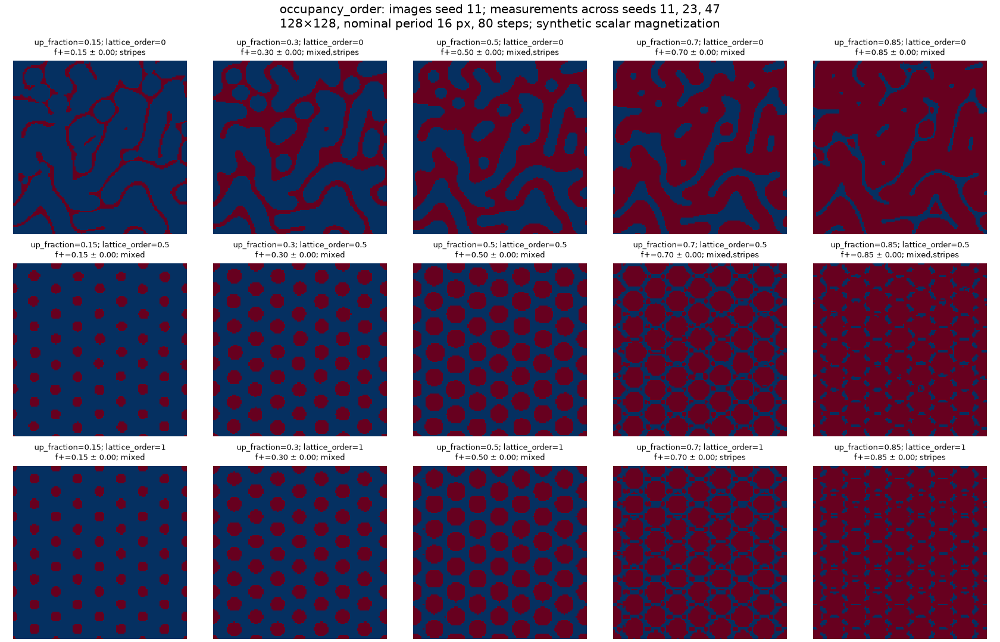
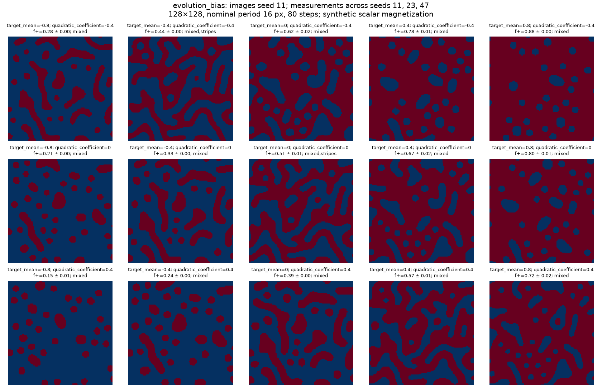
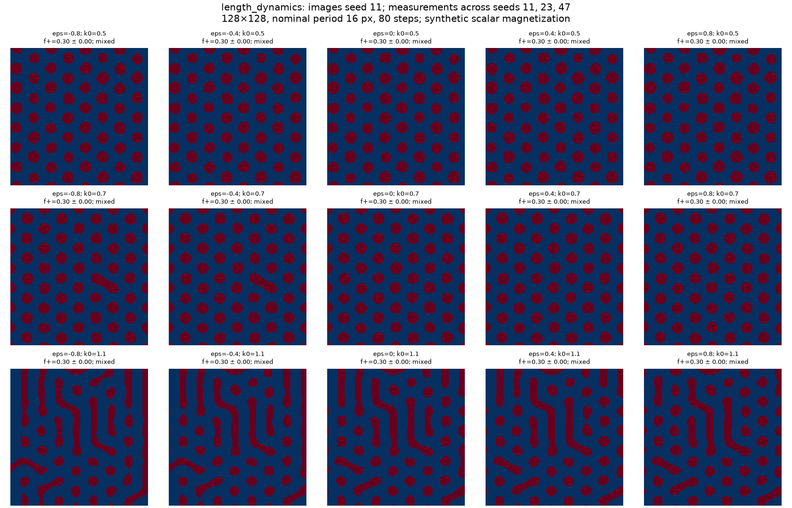
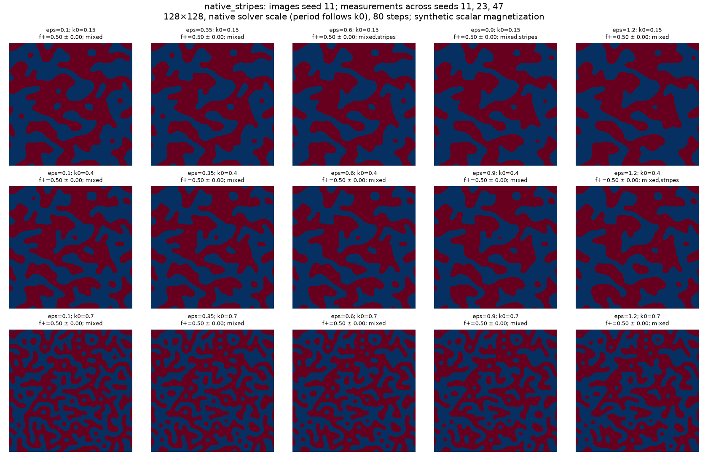

# General scalar magnetic domains and measured parameter catalogue

For the literature-based design of a constrained, dipolar magnetic-domain
backend, see [the model research and control specification](magnetic_domain_model_research.md).
The current catalogue characterizes the procedural generator, not a validated
micromagnetic surrogate.

`create_domain_pattern` generates labyrinths, unequal up/down domains, bubbles,
and ordered skyrmion-like scalar lattices using the same spectral evolution
model. It is available to all experiment workflows as `domain_pattern`.
The implementation is a synthetic Swift–Hohenberg-like field model, not a
micromagnetic energy minimizer. The returned scalar `mz` does not specify a
skyrmion winding, chirality, or topological charge.

## Use one generator

```python
from scattering_calculator.sample_generator import create_domain_pattern

mz, metadata = create_domain_pattern(
    (256, 256), period=24, up_fraction=0.3,
    lattice_order=0.0, target_mean=None,
    k0=0.7, eps=0.8, quadratic_coefficient=0.0,
    sigma=0.7, domain_conversion="hard", n_steps=80, seed=11,
)
# Set lattice_order=1 and up_fraction=0.15 for an ordered positive-bubble lattice.
# Set up_fraction=None to measure the fraction selected by the evolving field.
```

Direct calls use pixel lengths. Experiment configurations use metres:

```python
magnetic_pattern = sim.MagneticPatternConfig(
    pattern_type_method="domain_pattern",
    pattern_config={
        "period": 100e-9, "sigma": 4e-9,
        "up_fraction": 0.3, "lattice_order": 0.0,
        "target_mean": None, "seed": 11,
    },
)
```

This method creates a field across the simulation plane; the aperture clips it.
It does not constrain all domains to lie inside the object hole. The new method
is opt-in; existing `binary_labyrinth_pattern` configurations keep their
historical solver, threshold and FFT rescaling defaults.

Domains are fully magnetized at **+1 or -1 by default**. `up_fraction=0.3`
means 30% of the area at +1 and 70% at -1; it does not scale either amplitude.
The mean magnetization is consequently `2*f_up - 1`. Continuous contrast is
an explicit opt-in with `domain_conversion="soft"`.

## What each control means

| Control | Role | Interpretation and limits |
|---|---|---|
| `up_fraction` | Final positive-domain area fraction, from 0 to 1 | Quantile calibrated **after** resizing and smoothing. This is an output occupancy constraint, not an applied magnetic field. `None` leaves the natural zero-threshold fraction. |
| `target_mean` | Mean of the continuous field after each evolution step | Changes the morphology during evolution. It is neither a final area fraction nor the mean of `mz`. Leave `up_fraction=None` to observe its natural occupancy effect. |
| `quadratic_coefficient` | Breaks sign symmetry in the nonlinear evolution | Can favor bubble-like over connected patterns and shift occupancy; sign and magnitude must be evaluated with the other controls. |
| `field_bias` | Uniform offset applied during evolution | Biases one polarity. A simultaneous `target_mean` constraint can counteract it; these controls are not independent physical field calibrations. |
| `lattice_order` | Blend of random initial field (0) and three hexagonal seed waves (1) | Biases initial order; does not impose a final lattice. Intermediate values may relax to almost the same ordered phase. |
| `lattice_angle` | Rotation of the hexagonal seed, in radians | Domain order can evolve away from the initial seed. |
| `period` | Requested output length scale | Full repeat, approximately; not a skyrmion diameter. Evolution and quantile level change actual domain widths. |
| `k0`, `eps` | Preferred source wave number and spectral growth control | Change texture shape and evolution. Output rescaling separates `k0` from the requested output length scale. |
| `sigma`, `softness` | Spatial smoothing and tanh wall contrast | Change wall profiles; a soft magnetization mean need not equal `2*up_fraction-1`. |
| `n_steps`, `noise_amp`, `seed` | Relaxation, driving noise, reproducibility | A finite-step image is not proof of equilibrium. Catalogued examples use zero driving noise. |

The general method uses a semi-implicit cubic damping step to prevent runaway
isolated peaks from ordered seeds. `stable_evolution=False` selects the legacy
explicit update. Default `rescale_mode="nominal"` scales using the source `k0`;
it avoids unstable adaptive FFT sizing near phase separation or saturation.
`rescale_mode="measured"` uses the legacy dominant-FFT wavelength calibration.

For exact legacy labyrinth recovery at matching settings, also select
`domain_conversion="soft"`, `stable_evolution=False`, `rescale_mode="measured"`, and
`threshold_mode="median"`, with `domain_conversion="soft"`, `lattice_order=0`, `target_mean=None`,
`up_fraction=None`, `quadratic_coefficient=0`, and `field_bias=0`.
The existing generator remains available unchanged at its entry point.

## Measured atlas

The checked-in catalogue contains **180 generated samples**: four 15-cell
parameter slices, each repeated for seeds 11, 23 and 47. Images show seed 11;
titles report fraction mean and standard deviation and classifier labels over
all three seeds. The first three slices use 128×128 pixels, nominal period 16 pixels, 80 steps,
zero driving noise, sigma 0.7 pixels and hard +1/-1 domains. Unvaried controls use the
new generator defaults. This is a finite-resolution empirical catalogue, not a
thermodynamic phase diagram or a guarantee for arbitrary sizes and seeds.

### Occupancy versus initial lattice order



At `lattice_order=0`, the examples retain irregular connected labyrinths and
mixed domains. At `lattice_order=0.5` or `1`, positive occupancy 0.15–0.30 yields
an ordered array of separated positive cores. Changing occupancy changes core
size and connectivity as well as the polarity balance; it does not independently
set a skyrmion radius. A positive-core hexagonal seed is not sign-symmetric:
large positive occupancy need not yield an equally ordered negative-core lattice.

### Evolution mean versus symmetry breaking



Here `up_fraction=None`: occupancy is measured, not imposed. Increasing the
evolution mean increases positive occupancy in these sampled rows, while the
quadratic term shifts the relationship. For seed 11 at quadratic coefficient 0,
means -0.8, 0 and +0.8 give approximately 20%, 52% and 82% positive domains.
Do not substitute `target_mean` for an area fraction.

### Spectral dynamics at fixed occupancy



Here occupancy is fixed at 0.30 and initial lattice order at 0.5. Varying `eps`
and `k0` tests how shape and ordering change while holding positive occupancy
fixed. Measured labels and shape descriptors belong to these sampled settings,
not universal phase boundaries.

### Native labyrinthine stripe regimes from Tutorial 03



This slice restores the original broad labyrinthine stripe regimes: `k0` from
0.15 to 0.7, `eps` from 0.1 to 1.2, `target_mean=0`, no final occupancy
constraint, and the legacy explicit update (`stable_evolution=False`). As in
Tutorial 03, tiny enclosed holes up to 9 pixels are filled. There is no spatial
blur and output remains fully magnetized +1/-1. `rescale_mode="native"` runs
directly at the output resolution: **k0 sets the native length scale and the
requested period is not used**. The other three slices normalize the output
length scale, which obscured this useful part of the original parameter space.

## Measurements and reproducibility

- [JSON records](assets/domain_catalogue/catalogue.json): full input parameters,
  generator metadata and measured observables for every sample.
- [CSV records](assets/domain_catalogue/catalogue.csv): one row per generated
  sample; requested controls have a `parameter_` prefix.
- [Tutorial 22](../tutorials/22_general_magnetic_domains.ipynb): editable controls,
  natural-bias and controlled-occupancy comparisons, and saved atlas inspection.

`measure_domain_pattern` reports sign occupancy, soft mean magnetization,
dominant FFT period, bubble/stripe counts, component eccentricity/circularity and sixfold neighbor
order. The existing classifier labels clipped components as stripe-like because
it cannot establish their closed shape. Thus an ordered bubble lattice may be
labelled `mixed`. Sixfold order uses interior component centers with six nearest
neighbors; fewer than seven eligible components returns `None`. It measures
local center alignment, not magnetic topology or long-range crystalline order.

Regenerate without running any optical propagation:

```bash
PYTHONPATH=src python scripts/catalogue_magnetic_domains.py
```
